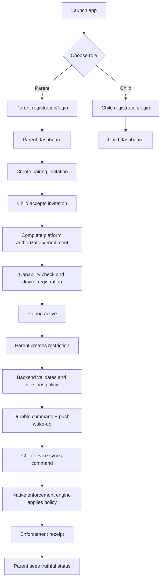
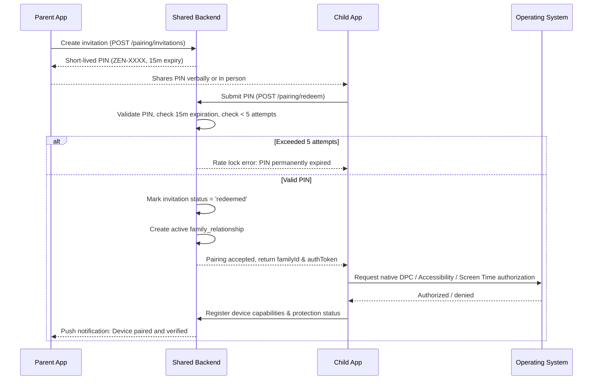
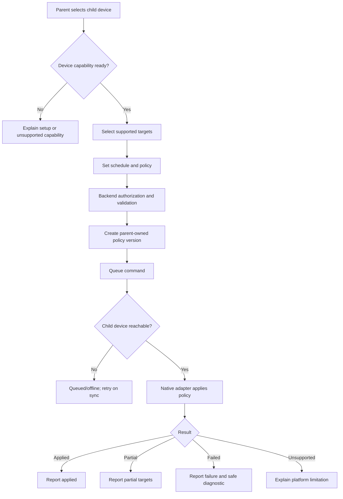
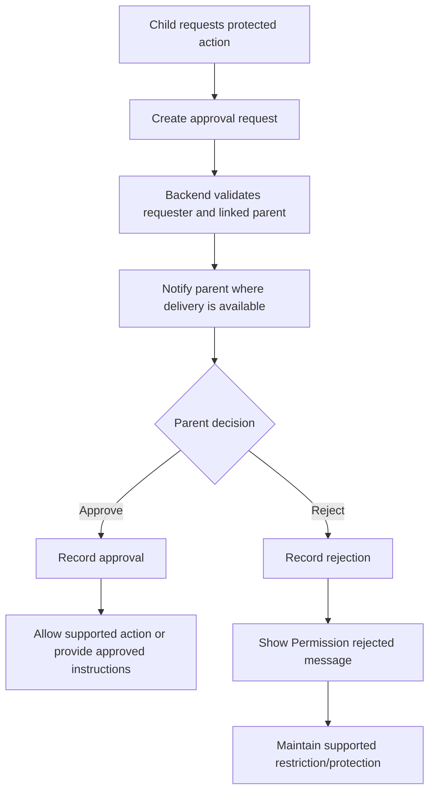

# Application Flow

## Cross-Platform Study Focus & Parental Control App

**Version:** 1.0 draft

------------------------------------------------------------------------

## 1. Product Flow Overview

The application starts with role selection, then authentication and a
role-specific onboarding flow. Both parent and child accounts can exist
on Android or iOS. The shared backend connects them; the child's native
enforcement engine applies supported restrictions.



## 2. First Launch and Role Selection

### Screen: Welcome

Display: - Product name and concise description. - "I am a Parent" - "I
am a Child" - Privacy and terms links.

The selected role determines the initial onboarding path, but the server
remains authoritative for permissions.

### Parent path

1.  Choose "I am a Parent."
2.  Register or sign in.
3.  Verify identity/contact as required.
4.  Review privacy and consent information.
5.  Reach Parent Dashboard.
6.  Create a child invitation or accept an existing relationship.

### Child path

1.  Choose "I am a Child."
2.  Register or sign in, or begin a parent-invited flow.
3.  Accept a valid parent invitation where applicable.
4.  Review a clear explanation of controls and permissions.
5.  Complete platform authorization/enrollment.
6.  Register device capabilities.
7.  Reach Child Dashboard with status indicators.

A user must not become a linked child merely by typing a parent's email
address. Pairing requires a valid invitation/approval process.

## 3. Parent-Child Pairing Flow



Pairing states:
- `invitation_created` (PIN valid for 15 minutes)
- `invitation_expired` (Exceeded 15m TTL or 5 failed attempts)
- `awaiting_child_acceptance`
- `awaiting_os_authorization`
- `awaiting_android_enrollment`
- `active`
- `restricted_capabilities`
- `revoked` (Parent unlinked device)

If native authorization or enrollment is not completed, the UI must not
show strong parental control as active.

## 4. Parent Dashboard Flow

Main areas: - Linked children/devices. - Device online/last-seen
status. - Platform and capability status. - Active restrictions. -
Schedule manager. - Pending approval requests. - Policy history/audit
events.

### Create a restriction

1.  Parent selects a child and target device.
2.  App fetches device capabilities and supported selection method.
3.  Parent selects supported apps/categories/domains.
4.  Parent sets timing: immediately, one-time window, or recurring
    schedule.
5.  UI previews what the platform can enforce.
6.  Parent confirms.
7.  Backend authenticates and authorizes the request.
8.  Backend creates a versioned parent-owned policy and durable command.
9.  Device receives a wake-up hint or syncs later.
10. Native adapter applies the policy.
11. Device reports applied/partial/failed/unsupported.
12. Parent dashboard updates status.

Policy status labels: - **Draft:** not submitted. - **Queued:** accepted
by backend, awaiting device. - **Pending authorization:** device
setup/permission incomplete. - **Applied:** device confirmed
enforcement. - **Partially applied:** some targets were not
enforceable. - **Failed:** attempted but not applied. - **Unsupported:**
OS/device does not expose required capability. - **Offline:** no recent
connection; actual current state may be unknown. - **Expired/removed:**
no longer desired, with receipt/reconciliation as applicable.

## 5. Child Dashboard Flow

Main areas:
- **Focus Timer & Engine Display**: Displays countdown timer, circular progress, and dynamic state badge (`● Focusing`, `⏸ Paused`, `☕ Break`, `Ready`).
- **Strict Mode Toggle**: Configures focus lockdown. When enabled, pause and premature cancellation buttons are locked to cultivate deep focus discipline.
- **Usage Access Permission Banner**: Displays real-time permission health. If Android Usage Access is missing, shows an honest banner with a direct shortcut to system settings (`ZenFocusDpcBridge.openUsageAccessSettings()`).
- **Active Restrictions & Source**: Lists blocked applications categorized by origin (Parent-Enforced vs Child Focus Session).
- **Scheduled Curfews**: Shows active bedtime or study hall windows with remaining duration.
- **Approval Requests & Help**: Facilitates requesting temporary unblocking from parents.

## 6. Focus Session State Machine Flow (`FocusEngine`)

Focus sessions follow an authoritative, deterministic 8-state lifecycle:

```mermaid
flowchart TD
    IDLE((IDLE)) -->|prepareSession| PREPARING[PREPARING<br/>Presets / Custom Duration]
    PREPARING -->|startFocus| FOCUSING[FOCUSING<br/>Native Blocks Active]
    PREPARING -->|cancel| CANCELLED((CANCELLED))
    FOCUSING -->|startBreak| BREAK[BREAK<br/>Temporary App Relief]
    BREAK -->|resumeFocus| FOCUSING
    BREAK -->|complete| COMPLETED((COMPLETED))
    FOCUSING -->|pause [!strictMode]| PAUSED[PAUSED<br/>Timer Halted]
    PAUSED -->|resumeFocus| FOCUSING
    PAUSED -->|cancel| CANCELLED
    FOCUSING -->|cancel [!strictMode]| CANCELLED
    FOCUSING -->|deadline elapsed| COMPLETED
    FOCUSING -->|system fault| ERROR((ERROR))
    ERROR -->|reset| IDLE
```

### Detailed Lifecycle Steps:

1. **Selection (`IDLE` $\rightarrow$ `PREPARING`)**:
   - Child selects duration preset (e.g., 25m Pomodoro, 50m Deep Work) or custom time.
   - Child configures Strict Mode toggle.
   - Child selects apps to restrict via platform-native picker (`FamilyActivityPicker` on iOS, package selector on Android).
2. **Activation (`PREPARING` $\rightarrow$ `FOCUSING`)**:
   - `FocusEngine.startFocus()` records wall-clock `startedAt = Date.now()` and authoritative `expiresAt = startedAt + durationMs`.
   - Initializes monotonic drift compensator (`performance.now()`).
   - Dispatches native blocking command to `ZenFocusDpcBridge.setPackagesSuspended(blockedApps, true)` on Android or `ManagedSettingsStore` on iOS.
3. **Active Enforcement (`FOCUSING`)**:
   - 1-second interval heartbeat updates UI based on authoritative deadline arithmetic: $\text{remainingSec} = \max(0, \lfloor(\text{expiresAt} - \text{now()})/1000\rfloor)$.
   - Strict Mode blocks cancellation and pausing.
   - In non-strict mode, child can transition to `PAUSED` or `BREAK`.
4. **Idempotent Completion (`FOCUSING` $\rightarrow$ `COMPLETED`)**:
   - Triggered automatically when $\text{now()} \ge \text{expiresAt}$.
   - Completion handler executes exactly once.
   - Removes child-owned native app restrictions (parent-owned restrictions remain active).
   - Increments completed focus sessions and recorded focus minutes in local and cloud analytics.
5. **Cold Restart & Reboot Recovery (`recoverSession`)**:
   - On app startup, `FocusEngine.recoverSession()` inspects persisted state from `AsyncStorage`.
   - If $\text{now()} \ge \text{expiresAt}$, automatically transitions state to `COMPLETED` without duplicate notification.
   - If session is still active, recalculates exact remaining seconds using the authoritative deadline, resumes heartbeat, and re-applies native restrictions.

## 7. Parent Restriction Flow



Removing a restriction is also a parent-authorized, versioned policy
change. A child cannot remove the policy from their own dashboard or
submit an equivalent command as the parent.

## 8. Cross-Platform Parent Control

### Case A: iOS parent → Android child

1.  Parent selects the Android child's device in the iOS parent app.
2.  iOS app sends policy intent to shared backend.
3.  Backend checks parent-child link, target device, policy owner, and
    current capabilities.
4.  Backend queues an Android-targeted command.
5.  FCM/push may wake the child app; the child app also syncs on
    permitted lifecycle events.
6.  Kotlin DPC adapter applies supported DevicePolicyManager operations.
7.  Child device sends enforcement receipt.
8.  iOS parent dashboard shows confirmed status.

### Case B: Android parent → iOS child

1.  Parent selects the iOS child's device in the Android parent app.
2.  Android app sends policy intent to shared backend.
3.  Backend validates relationship, authorization, and policy.
4.  Backend queues an iOS-targeted command.
5.  APNs/push may wake the child app; the iOS client/extension follows
    platform-allowed execution patterns.
6.  Swift adapter applies supported FamilyControls/ManagedSettings
    policy and DeviceActivity schedule.
7.  Child device reports status where the platform permits.
8.  Android parent dashboard shows confirmed, pending, partial, or
    unsupported status.

Cross-platform commands carry platform-neutral intent plus a
target-device-specific reference. iOS opaque selection tokens cannot be
treated as Android package IDs, and Android package names cannot be
assumed to map one-to-one to iOS app tokens.

## 9. Notification Suppression Flow

### Android

1.  Parent policy identifies a supported app.
2.  Device capability check confirms eligible DPC management state.
3.  DPC requests package suspension for the selected package where
    permitted.
4.  Android suppresses notifications for the suspended package as part
    of the OS behavior.
5.  Adapter reports success or names packages that could not be
    suspended.
6.  DND may be used as an additional focus layer only with required
    authorization.

If the device is not eligible for DPC suspension, show the actual
supported alternative and do not claim full notification suppression.

### iOS

1.  Parent/guardian authorization and Family Controls entitlement are
    verified.
2.  Supported app/category/domain tokens are selected.
3.  ManagedSettings applies the relevant shield/restriction.
4.  DeviceActivity manages supported schedules.
5.  Test notification behavior on the targeted OS version and report
    only verified capability.

App shielding must not be described as a guarantee that all
notifications from the selected app disappear.

## 10. Uninstall / Protected-Action Approval Flow

The app should distinguish a **request workflow** from a guaranteed
interception of the operating system's uninstall UI.



Platform notes: - **Android:** `setUninstallBlocked()` may be used only
in eligible device-owner/device-management configurations. Do not
promise that a normal app can intercept every uninstall attempt. -
**iOS:** Family Controls guardian authorization provides supported
protections against removal of an authorized parental-control app in
applicable circumstances. Do not implement a fake lock screen or claim
to override iOS system UI. - If an OS does not provide a reliable hook
for intercepting an attempt, the product may provide an in-app request,
guardian authorization flow, or a setup-time protection configuration,
but must explain the limitation.

A rejection can display "Permission rejected." The screen must not
automatically lock unless a specific supported, authorized system
capability exists and the behavior is safe and transparent.

## 11. Approval Request States

-   `pending`
-   `approved`
-   `rejected`
-   `expired`
-   `cancelled`
-   `action_completed`
-   `action_not_supported`

Every decision records the authenticated parent, timestamp, target
device, request type, and outcome. Push delivery is not proof that the
parent saw the request.

## 12. Offline and Error Flows

### Child device offline

-   Parent sees "Queued --- device offline" and last-seen time.
-   Backend retains the latest desired policy and durable command.
-   Existing local schedules remain active where the OS supports local
    enforcement.
-   New changes cannot be confirmed until the device reconnects.
-   On reconnection, the device fetches current policy and reconciles by
    version.

### Authorization revoked

-   Child client reports degraded capability when possible.
-   Parent dashboard shows "Authorization required" or "Protection
    degraded."
-   The app explains the required system steps.
-   Do not claim restrictions remain enforced if the OS has stopped
    honoring them.

### Partial enforcement

-   Device reports applied and failed targets separately or with safe
    error codes.
-   Parent sees which items are not enforced.
-   Unsupported system apps are not silently reported as blocked.

### Expired or replayed command

-   Device rejects stale/expired command.
-   Backend retains audit trail.
-   Client requests latest policy state.

### Account unpairing

-   Backend revokes relationship and future command authorization.
-   Device performs policy cleanup/reconciliation according to platform
    rules and clearly communicates the resulting protection state.
-   Keep audit records according to retention policy.

## 13. Suggested Screen Inventory

### Shared authentication

-   Welcome / role selection
-   Sign up / sign in
-   Recovery
-   Privacy and consent
-   Pairing invitation / code entry

### Parent

-   Parent dashboard
-   Child/device details
-   Capability setup guide
-   App/category selection
-   Restriction editor
-   Schedule editor
-   Active policies
-   Approval inbox
-   Approval details
-   Policy history
-   Account/family settings

### Child

-   Child dashboard
-   Focus timer
-   Focus target selection
-   Active restriction details
-   Parent restriction explanation
-   Request permission
-   Request status
-   Device authorization/enrollment setup
-   Privacy/help
-   Account settings

### Platform-specific setup

-   Android DPC provisioning and device-owner eligibility explanation
-   Android DND permission explainer
-   iOS Family Controls authorization
-   iOS Family Sharing/guardian authorization explanation
-   Unsupported capability and recovery states

## 14. User-Facing Language Guidelines

Use: - "Restriction applied on this device." - "Waiting for device
confirmation." - "This device needs additional setup." - "Some selected
apps cannot be restricted on this device." - "Notification suppression
is not supported for this target." - "Parent approval is required for
this request."

Avoid: - "All notifications are blocked" unless verified for that exact
mechanism. - "Your child can never uninstall this app" as a universal
guarantee. - "Device locked" when only an app shield is active. -
"Applied" when only the backend has accepted a request.

## 15. End-to-End MVP Test Scenarios

1.  Parent Android + child Android, supported restriction.
2.  Parent iOS + child iOS, supported restriction.
3.  Parent iOS + child Android, cross-platform restriction.
4.  Parent Android + child iOS, cross-platform restriction.
5.  Child removes own focus restriction without affecting parent policy.
6.  Child tries to remove parent policy through UI and direct API
    request.
7.  Parent removes policy and device confirms removal.
8.  Device offline during policy update, then reconnects.
9.  Duplicate command and out-of-order policy versions.
10. DPC not provisioned or loses eligibility.
11. iOS Family Controls authorization denied/revoked.
12. Notification suppression behavior tested on each supported
    OS/device.
13. Uninstall request approved and rejected; verify only supported
    system controls are claimed.
14. Parent account revoked or child unpaired.
15. App update and OS update preserve or clearly report policy status.
