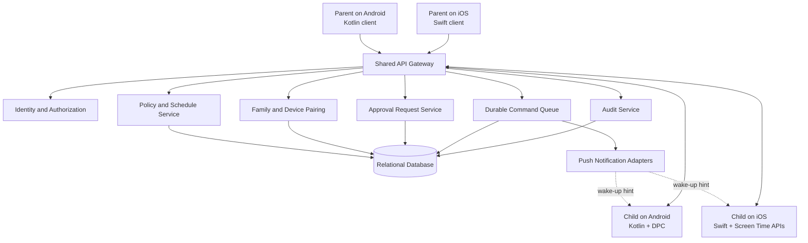
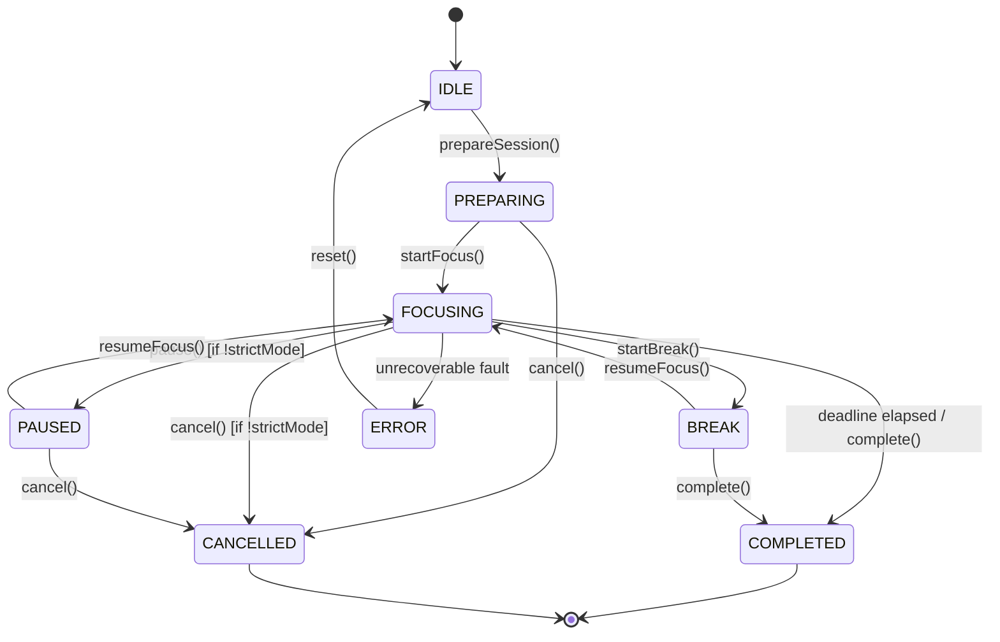

# System Architecture

## Cross-Platform Study Focus & Parental Control App

**Version:** 1.0 draft\
**Architecture principle:** One shared backend; separate native Android
and iOS clients/enforcement engines.

------------------------------------------------------------------------

## 1. Architecture Goals

-   Support parent and child accounts on either Android or iOS.
-   Allow a parent on one platform to manage a child on the other
    platform.
-   Keep the backend authoritative for identities, parent-child
    relationships, policy ownership, schedules, approvals, and
    synchronization.
-   Enforce restrictions locally through the target device's supported
    native APIs.
-   Avoid claiming an action is enforced until the child device reports
    the result.
-   Preserve privacy by minimizing collected data and never uploading
    notification contents.

## 2. System Context



Push is a best-effort wake-up hint. The durable backend queue and
authenticated device synchronization are the source of truth.

## 3. Logical Layers

### 3.1 Native client layer

Each platform has a parent dashboard and child dashboard, which can be
shown according to the authenticated user's role.

Responsibilities: - Login/session management. - Pairing and device
setup. - Policy configuration UI. - Focus timer UI. - Approval request
UI. - Capability explanation and status display. - Local secure token
storage. - Sending commands to the backend and displaying results.

The UI is not the security boundary. Every sensitive action is validated
by the backend and enforced by the native target device.

### 3.2 Shared backend

Recommended logical services (these can begin as a modular monolith
rather than separate microservices):

1.  **Identity service:** registration, login, sessions, recovery,
    account state.
2.  **Relationship service:** parent-child relationships, invitations,
    revocation.
3.  **Device registry:** device registration, platform, capability
    state, authorization/enrollment state, last-seen time.
4.  **Policy service:** policy creation, versioning, ownership,
    schedules, conflict resolution.
5.  **Command service:** durable command creation, delivery attempts,
    expiry, acknowledgement, idempotency.
6.  **Approval service:** request lifecycle and parent decisions.
7.  **Push adapter:** APNs/FCM notifications containing minimal wake-up
    information.
8.  **Audit service:** append-only security-relevant events.
9.  **Observability:** metrics, redacted logs, tracing, alerting.

### 3.3 Native enforcement adapters

The enforcement engine runs on the child device, not on the parent's
phone or the server.

**Android adapter (Kotlin):**
- Device Policy Controller (`ZenFocusDpcModule`) implementation.
- `DevicePolicyManager` integration: eligible `setPackagesSuspended()` and `setUninstallBlocked()` operations for Device Owner / Profile Owner.
- Accessibility Service (`ZenFocusAccessibilityService`) foreground window detection and blocking intervention overlay when non-DO.
- `UsageStatsManager` tracking (`ZenFocusUsageStatsTracker`): daily foreground time aggregation, interval deduplication, and strictly zero data fabrication (`permissionGranted: false` and 0 minutes when unauthorized).
- DND / notification policy integration (`NotificationManager.isNotificationPolicyAccessGranted`) only after explicit user authorization.
- Honest enforcement status checks: `protectionActive = isDeviceOwner || isAccessibilityEnabled`.
- Local policy cache, schedule evaluation, and enforcement receipt reporting.

**iOS adapter (Swift):**
- Family Controls authorization and entitlement checks (`AuthorizationCenter.shared`).
- `FamilyActivityPicker` / `FamilyActivitySelection` for supported selection.
- ManagedSettings shields and restrictions (`ManagedSettingsStore(named: ...)` with store isolation).
- DeviceActivity schedules and monitoring extensions (`DeviceActivityMonitorExtension`).
- App Groups (`group.com.zenfocus.app`) for secure shared state between main app and extensions.
- Local policy cache and result reporting.
- Capability checks for authorization, selected tokens, and active schedules.

The server must not assume Android package names and iOS opaque app tokens are interchangeable. A platform-specific target reference belongs to the device that created it.

### 3.4 Shared Focus Session Engine (`FocusEngine`)

A deterministic, cross-platform state machine implemented in TypeScript (`mobile/src/engine/FocusEngine.ts`) and shared across Android and iOS clients:



- **8-State Deterministic FSM**: Strictly validated transition matrix rejecting invalid state jumps.
- **Authoritative Deadline Arithmetic**: Session remaining duration is computed from `deadline = startedAt + durationMs`, eliminating unbounded drift from naive interval callbacks.
- **Monotonic Clock Drift Compensation**: Compares monotonic wall clock intervals (`Date.now()` vs `performance.now()`) to detect and correct device clock shifts or background suspension delays.
- **Cold Restart & Reboot Recovery (`recoverSession`)**: Evaluates persisted session state against the authoritative deadline; automatically transitions expired sessions to `COMPLETED` and restores active sessions with correct remaining seconds without double-triggering completion events.
- **Strict Mode Protection**: Rejects `pause()` and `cancel()` calls during active focus unless an explicit emergency protocol is authenticated.
- **Idempotent Completion**: Guarantees completion events execute once, preventing duplicate analytics or reward double-counting.

## 4. Cross-Platform Command Lifecycle

Example: parent on iOS blocks a selected app on an Android child's
device.

1.  Parent configures a policy in the iOS app.
2.  Client submits policy intent to the backend over TLS.
3.  Backend authenticates the session and verifies parent-child
    relationship and policy authority.
4.  Backend validates the target device's capability state and the
    policy schema.
5.  Backend saves the new policy version and creates a durable command.
6.  Push adapter sends a minimal wake-up notification if possible.
7.  Android child client syncs and retrieves authorized pending
    commands.
8.  Android adapter validates command ID, target device, version,
    expiry, and local management state.
9.  Adapter applies the supported native policy.
10. Adapter reports a result with applied/partial/failed/unsupported
    status and a safe error code.
11. Backend stores the receipt and updates the parent dashboard.
12. On reconnection, device sync reconciles to the latest policy
    version.

The reverse direction uses the same lifecycle; the iOS child adapter
translates the policy into supported Family Controls / ManagedSettings
operations.

## 5. Policy Model, Ownership, and Synchronization Engine (`PolicySyncEngine`)

Every restriction has immutable ownership semantics:

- `PARENT`: only an authenticated, paired parent can create, modify, or remove it.
- `CHILD`: the child can only mutate child-owned focus session policies.
- A child-owned policy cannot override, cancel, or downgrade a parent-owned policy.

### 5.1 Monotonic Policy Versioning and Stale Rejection

To protect against race conditions, out-of-order push deliveries, and network replay attacks:
1. Every policy update increments an integer `policy_version` monotonically at the database layer.
2. When the child device sync engine (`mobile/src/engine/PolicySyncEngine.ts`) receives a policy:
   - If `incomingVersion <= localVersion`, the command is rejected as **stale**.
   - If `incomingVersion > localVersion`, the policy is accepted, applied to local storage, and the local version counter advances.
3. Durable commands are stored in an indexed queue with idempotency keys (`idempotency_key = <deviceId>_<version>_<timestamp>`).

### 5.2 Multi-Schedule Priority Hierarchy

When multiple parent and child restriction schedules overlap, the synchronization engine evaluates effective restrictions using an authoritative priority hierarchy:

| Schedule Type | Priority Weight | Rule & Override Behavior |
| :--- | :---: | :--- |
| **Bedtime Restriction** | **100** | Night curfew. Overrides study breaks and leisure allowances. |
| **School / Study Hall** | **80** | Daytime school hours. Enforces academic apps only. |
| **Study Session** | **50** | Ad-hoc or scheduled session. Blocks distracting apps/categories. |

**Union Rule**: The effective blocked application list is computed as the mathematical union across all active schedules:
$$\text{Blocked}_{\text{effective}} = \bigcup_{s \in \text{ActiveSchedules}} s.\text{blockedTargets} \cup \text{ParentAlwaysBlocked}$$
No child session or lower-priority schedule can unblock an application that is denied by an active higher-priority schedule or parent restriction.

### 5.3 Single-Use Pairing PIN Lifecycle

Pairing establishes a cryptographically verifiable parent-child relationship:

```
[Parent Device]                         [Backend]                       [Child Device]
       |                                    |                                  |
       |--- POST /pairing/invitations ----->|                                  |
       |    (Generate ZEN-XXXX)             |                                  |
       |<-- Returns PIN (15m expiry) -------|                                  |
       |                                    |                                  |
   Displays PIN                             |                              Child enters PIN
       |                                    |<-- POST /pairing/redeem ---------|
       |                                    |    Validate PIN, expiry, rate    |
       |                                    |    Increment attempt_count       |
       |                                    |    Mark status = 'redeemed'      |
       |                                    |--- Create family_relationship -->|
       |<-- Relationship Active Notification|                                  |
```

- **PIN Format**: Human-readable `ZEN-XXXX` (4 uppercase alphanumeric characters).
- **Strict Expiration**: 15 minutes (`expires_at = now() + 15 min`).
- **Brute-Force Rate Limiting**: 5 consecutive failed attempts lock the invitation permanently (`status: 'expired'`), preventing automated dictionary attacks.
- **Single-Use Redemption**: Instantly transitions to `redeemed` upon verification; re-entry of the same PIN is rejected.
- **Revocation**: Parents can revoke pairing at any time via `DELETE /pairing/devices/{deviceId}`, immediately setting the relationship and device to `revoked`.

## 6. Data Model and Row Level Security (RLS)

The system utilizes a relational PostgreSQL database (compatible with Supabase) defined in `backend/migrations/001_initial_schema.sql`. All primary identifiers are UUIDv4.

### 6.1 Core Tables

1. **`users`**: Platform identity (`id`, `email`, `role`, `created_at`, `updated_at`).
2. **`family_relationships`**: Links parent to child with status (`pending`, `active`, `revoked`).
3. **`devices`**: Device registry with platform (`android`, `ios`), `is_device_owner`, `is_accessibility_enabled`, `has_usage_permission`, `protection_active`, `push_token`, and `last_sync_at`.
4. **`pairing_invitations`**: Expiring 15-minute PIN records (`pin_code`, `parent_user_id`, `expires_at`, `attempt_count`, `status`).
5. **`restriction_policies`**: Monotonically versioned policies (`owner_type`, `policy_type`, `version`, `target_identifiers`, `schedule_config`, `is_active`).
6. **`policy_receipts`**: Child device enforcement acknowledgements (`status: applied|partial|failed|unsupported`, `applied_version`, `error_code`, `diagnostic`).
7. **`focus_sessions`**: Authoritative session persistence (`user_id`, `device_id`, `state`, `focus_duration_minutes`, `break_duration_minutes`, `strict_mode`, `started_at`, `expires_at`, `completed_at`, `drift_compensation_ms`).
8. **`schedules`**: Recurring restriction time windows (`days_of_week`, `start_time`, `end_time`, `priority`, `blocked_targets`).
9. **`daily_usage_summaries`**: Daily screen-time totals (`package_name`, `category`, `foreground_minutes`, `date`). Non-fabricated; recorded only with explicit usage access.
10. **`audit_events`**: Immutable append-only log of security-sensitive operations (`actor_id`, `action`, `target_id`, `payload`, `ip_address`).

### 6.2 Row Level Security (RLS) Enforcement

Every table enforces PostgreSQL Row Level Security to prevent unauthorized multi-tenant data access:

- **Parent Data Isolation**:
  ```sql
  CREATE POLICY parent_read_children ON users
      FOR SELECT USING (
          auth.uid() = id OR
          EXISTS (SELECT 1 FROM family_relationships WHERE parent_user_id = auth.uid() AND child_user_id = users.id AND status = 'active')
      );
  ```
- **Child Policy Mutation Protection**:
  ```sql
  CREATE POLICY child_modify_own_policies_only ON restriction_policies
      FOR UPDATE USING (
          (owner_type = 'child' AND owner_user_id = auth.uid()) OR
          (owner_type = 'parent' AND EXISTS (
              SELECT 1 FROM family_relationships
              WHERE parent_user_id = auth.uid() AND child_user_id = restriction_policies.owner_user_id AND status = 'active'
          ))
      );
  ```
  Children are cryptographically prevented from altering `owner_type = 'parent'` policies.
- **Device Receipt Ownership**: Child devices may only insert receipts matching their own authenticated `device_id`.

## 7. API Design

All routes use `/v1`. JSON examples are illustrative, not final
contracts.

### Authentication

-   `POST /auth/register`
-   `POST /auth/login`
-   `POST /auth/refresh`
-   `POST /auth/logout`
-   `POST /auth/recovery`

### Pairing and relationships

-   `POST /pairing/invitations`
-   `POST /pairing/accept`
-   `GET /families/{familyId}/children`
-   `DELETE /families/{familyId}/children/{childId}`

### Devices

-   `POST /devices/register`
-   `PATCH /devices/{deviceId}/capabilities`
-   `GET /children/{childId}/devices`
-   `POST /devices/{deviceId}/sync`

### Policies

-   `GET /devices/{deviceId}/policies`
-   `POST /children/{childId}/policies`
-   `PATCH /policies/{policyId}`
-   `DELETE /policies/{policyId}`

### Commands and receipts

-   `GET /devices/{deviceId}/commands?cursor=...`
-   `POST /devices/{deviceId}/commands/{commandId}/ack`
-   `POST /devices/{deviceId}/enforcement-receipts`

### Approvals

-   `POST /approval-requests`
-   `GET /approval-requests`
-   `POST /approval-requests/{requestId}/decision`

### Audit

-   `GET /audit-events`

Security rules: - Check authorization for every request on the server. -
Derive actor identity from the authenticated session, not a body
field. - Verify that the parent is actively paired with the target
child. - Verify that a child can only mutate child-owned policies. -
Require idempotency keys for policy-changing requests. - Reject expired,
replayed, or wrong-device commands. - Rate-limit pairing and approval
endpoints. - Return minimal error details to clients; log safe
diagnostics server-side.

## 8. Command Contract

Example policy command:

``` json
{
  "commandId": "uuid",
  "targetDeviceId": "uuid",
  "policyId": "uuid",
  "policyVersion": 12,
  "issuedAt": "2026-10-15T08:00:00Z",
  "expiresAt": "2026-10-15T08:10:00Z",
  "operation": "APPLY_POLICY",
  "policy": {
    "ownerType": "parent",
    "policyType": "app_block",
    "desiredState": "active",
    "scheduleId": "uuid"
  }
}
```

Avoid placing unnecessary personal data or app usage contents in push
payloads. A push should generally say "new policy available" and let the
authenticated client fetch the command.

## 9. Offline and Reconciliation Behavior

-   Device caches the last successfully synchronized policy set in
    secure/local app storage where appropriate.
-   Native OS-managed schedules should enforce locally where the
    platform supports it.
-   New parent commands cannot be guaranteed while the child device is
    offline.
-   On reconnect, client requests current policy version and pending
    commands.
-   Client applies the authoritative latest state, not an unbounded
    sequence of stale intermediate commands.
-   Device reports last sync time and policy version.
-   If the native authorization is revoked or the DPC loses required
    management status, client reports degraded protection.
-   Parent dashboard clearly differentiates "desired policy saved" from
    "enforcement confirmed."

## 10. Security Architecture

### Authentication and sessions

-   Use a vetted identity provider or well-reviewed authentication
    implementation.
-   Use short-lived access tokens and refresh-token rotation.
-   Store tokens in Android Keystore-backed secure storage / iOS
    Keychain.
-   Support remote session revocation and reauthentication for sensitive
    actions.

### Authorization

-   Server-side role and relationship checks on every endpoint.
-   Parent permissions scoped to linked child devices only.
-   Child cannot update parent-owned policies or fabricate enforcement
    receipts.
-   Devices authenticate as registered devices; consider per-device keys
    and request signing for higher assurance.

### Transport and storage

-   TLS in transit.
-   Encrypt sensitive server data at rest.
-   Use managed secrets, never hard-code server credentials.
-   Separate development, staging, and production environments.
-   Minimize PII in logs and analytics.

### Threats to address

-   Parent account takeover.
-   Pairing code brute force or reuse.
-   Child forges parent role in API body.
-   Child replays an old "remove restriction" command.
-   A stale device command overrides a newer policy.
-   Unauthorized device submits a fake enforcement receipt.
-   Push token theft or reassignment.
-   Database leakage of pairing tokens or platform-specific targets.
-   Policy conflicts and time manipulation.
-   Rooted/jailbroken device or revoked system authorization.

### Mitigations

-   MFA/passkeys where feasible.
-   Short-lived hashed pairing tokens, expiry, attempt limits, and
    single use.
-   Monotonic policy versions and idempotency.
-   Per-device registration proof.
-   Server-authoritative policy ownership.
-   Audited high-risk actions.
-   Honest status when platform integrity cannot be verified.
-   Security review before production.

## 11. Platform-Specific Constraints

### Android

-   `DevicePolicyManager.setPackagesSuspended()` is available to
    eligible device/profile owners or delegated package-access roles.
-   Suspension hides notifications and prevents the package from
    starting, but some system/critical packages cannot be suspended.
-   `setUninstallBlocked()` is available only in eligible
    device-management configurations.
-   Device-owner provisioning and consumer setup friction must be
    validated early.
-   DND requires appropriate user/system access and is not equivalent to
    package suspension.
-   Do not use accessibility services as a covert substitute for
    supported management APIs.

### iOS

-   Family Controls requires capability/entitlement and Apple's approval
    for distribution.
-   Guardian authorization follows Apple's supported
    family/authorization flow.
-   ManagedSettings shields apps/categories/domains represented by
    supported selection tokens.
-   DeviceActivity supports schedules and monitoring extensions.
-   Do not assume universal notification suppression, arbitrary app
    inventory, or unrestricted remote device commands.
-   Test on physical devices and the exact OS versions targeted.

## 12. Observability and Operational Readiness

Metrics: - Registration/pairing success rate. - Device
authorization/enrollment completion. - Command queue age and delivery
latency. - Enforcement success/partial/failure rate by platform and OS
version. - Last successful sync. - Approval request delivery/decision
latency. - API error and authentication failure rates.

Do not log notification contents, private app content, or full sensitive
selection data.

## 13. Deployment Recommendation

Start with a modular backend (for example, a single well-structured
service plus a relational database and queue/outbox) rather than
premature microservices.

Production components: - API service. - Relational database with backups
and migrations. - Durable command/outbox table or queue. - Push
notification integration (FCM/APNs). - Secrets manager. - Centralized
redacted logs, metrics, and alerts. - Separate dev/staging/prod
environments. - CI checks, dependency scanning, signing, and release
approvals.

## 14. Technical Validation Checklist

Before committing to a release promise: - \[ \] Provision Android DPC on
each supported setup path. - \[ \] Test package suspension and
notification suppression on physical devices. - \[ \] Test system apps
that cannot be suspended. - \[ \] Test uninstall blocking only in
eligible configurations. - \[ \] Test DND behavior across Android
versions/OEMs. - \[ \] Obtain and validate Apple's Family Controls
entitlement. - \[ \] Test guardian authorization and app shielding on
physical iPhones. - \[ \] Verify DeviceActivity schedules when the app
is not open. - \[ \] Measure notification behavior rather than assuming
it. - \[ \] Test cross-platform parent-to-child commands. - \[ \] Test
offline, expired, duplicated, reordered, and replayed commands. - \[ \]
Test account unlinking, authorization revocation, and reinstall flows. -
\[ \] Review Google Play and App Store policy requirements.

## 15. Official References

-   Android DevicePolicyManager:
    https://developer.android.com/reference/android/app/admin/DevicePolicyManager
-   Android Enterprise DPC security:
    https://developer.android.com/work/dpc/security
-   Apple Screen Time frameworks:
    https://developer.apple.com/documentation/ScreenTimeAPIDocumentation
-   Apple Family Controls:
    https://developer.apple.com/documentation/familycontrols
