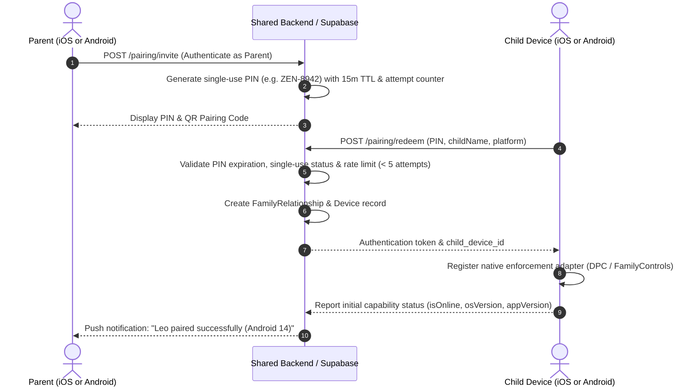

# 🛡️ ZenFocus Parental Control Architecture

## 1. Executive Summary & Design Philosophy
ZenFocus is designed around the core principle of **authoritative parental supervision combined with student study empowerment**. Unlike invasive spyware, ZenFocus does not record keystrokes, intercept personal messages, or covertly record screens. Instead, it leverages operating-system-level restriction primitives (**Android Device Policy Controller & Accessibility Services**; **Apple Screen Time & Family Controls**) to build healthy digital study habits.

Key architectural tenets:
1. **Immutable Ownership Model**: Any restriction created or locked by a guardian (`ownerType: 'parent'`) is strictly unmodifiable, un-deletable, and un-bypassable by child accounts.
2. **Student Self-Shield Agency**: Students can self-impose shields on distracting apps (`ownerType: 'child'`) to build Pomodoro study discipline.
3. **Union Rule Enforcement**: The effective restriction set on any device at any given millisecond is the mathematical union of all active parent rules and active child rules. Child actions can only *add* restrictions, never subtract parent-locked rules.
4. **Transparent Grace Periods**: Children can submit exception requests with homework justifications; parents approve or deny with real-time feedback and automatic timer-based grace unlocks.

---

## 2. Parent-Child Pairing & Device Onboarding Lifecycle



### Security & Anti-Tamper Safeguards:
- **Expiring Pairing PINs**: PINs expire after 15 minutes. Expired codes are marked `EXPIRED` and rejected.
- **Brute-Force Rate Limiting**: After 5 failed redemption attempts, the PIN is transitioned to `LOCKED` status.
- **Single-Use Guarantee**: Once redeemed, the PIN transitions to `REDEEMED` and cannot be replayed.
- **Anti-Hijacking**: A child device cannot be reassigned to a different parent account without explicit revocation by the original parent.
- **Device Revocation**: When a parent revokes a device, all authentication tokens are invalidated and pending commands are immediately pruned from the durable queue.

---

## 3. Policy Model & Conflict Resolution

### 3.1 Data Schema
Each restriction policy record contains:
```typescript
interface RestrictionPolicy {
  id: string;                      // Unique UUID
  familyRelationshipId: string;    // Foreign key to verified family relationship
  targetDeviceId: string;          // Target child hardware profile
  ownerType: 'parent' | 'child';   // Authoritative ownership tag
  policyType: 'app_block' | 'category_block' | 'domain_block' | 'focus_session';
  targetPackage: string;           // Android package (e.g. com.zhiliaoapp.musically) or iOS bundle ID
  appName: string;                 // Human-readable app name
  appCategory: 'Social' | 'Entertainment' | 'Gaming' | 'Productivity' | 'Utilities';
  desiredState: 'active' | 'inactive';
  version: number;                 // Monotonically increasing version counter
  createdAt: string;
  updatedAt: string;
}
```

### 3.2 Schedule Conflict Resolution
When multiple schedules or timer states overlap, ZenFocus enforces a strict priority hierarchy:

| Priority Rank | Schedule Type | Example Window | Override Behavior |
| :--- | :--- | :--- | :--- |
| **1 (Highest)** | **Bedtime Downtime** | 21:00 – 07:00 | Overrides all study sessions and study breaks. Shields cannot be lifted. |
| **2** | **School Hours** | 08:00 – 15:30 | Overrides child self-settings. Distractions strictly suspended. |
| **3** | **Parent Evening Study** | 17:00 – 19:00 | Parent-mandated focus window. |
| **4** | **Student Focus Session** | Active 45m Pomodoro | Self-imposed shields active. |
| **5 (Lowest)** | **Study Break** | 5m – 15m interval | Lifts self-imposed shields ONLY if Bedtime and School schedules are NOT active. |

---

## 4. Exception Requests & Grace Unlocks
When a student needs an app for study (e.g. Duolingo for language practice, YouTube for an educational lecture):
1. **Student Request**: Student taps "Request Exception", selects duration (+15m, +30m, +60m), and enters homework justification.
2. **Push to Guardian**: Parent receives high-priority notification with child's name, requested app, and reason.
3. **Parent Approval**: With 1 tap, parent approves +30m.
4. **Temporary Unlock Execution**:
   - Backend issues temporary grace policy with `expiresAt = now + 30m`.
   - Native adapter lifts restriction for the target package.
   - Child app displays countdown banner: `🔓 Duolingo temporarily unblocked (+30m granted)`.
5. **Authoritative Expiry**: At `expiresAt`, the native adapter re-applies the restriction automatically without requiring parent intervention.

---

## 5. Multi-Child Device Management
Parents with multiple children (e.g. Leo on Galaxy S24, Maya on iPhone 15 Pro) manage each child independently:
- **Child-First UX**: Screen displays the child's name ("Leo", "Maya"), avoiding confusing hardware serials.
- **Dynamic Platform Adaptation**: When the parent selects Leo, the dashboard renders Android DPC controls and package suspension. When the parent selects Maya, the dashboard renders Apple Screen Time controls, `FamilyActivityPicker` shields, and App Group configurations.
- **Cross-Platform Parity**: An iOS parent can manage an Android child, and an Android parent can manage an iOS child with 100% policy parity.
