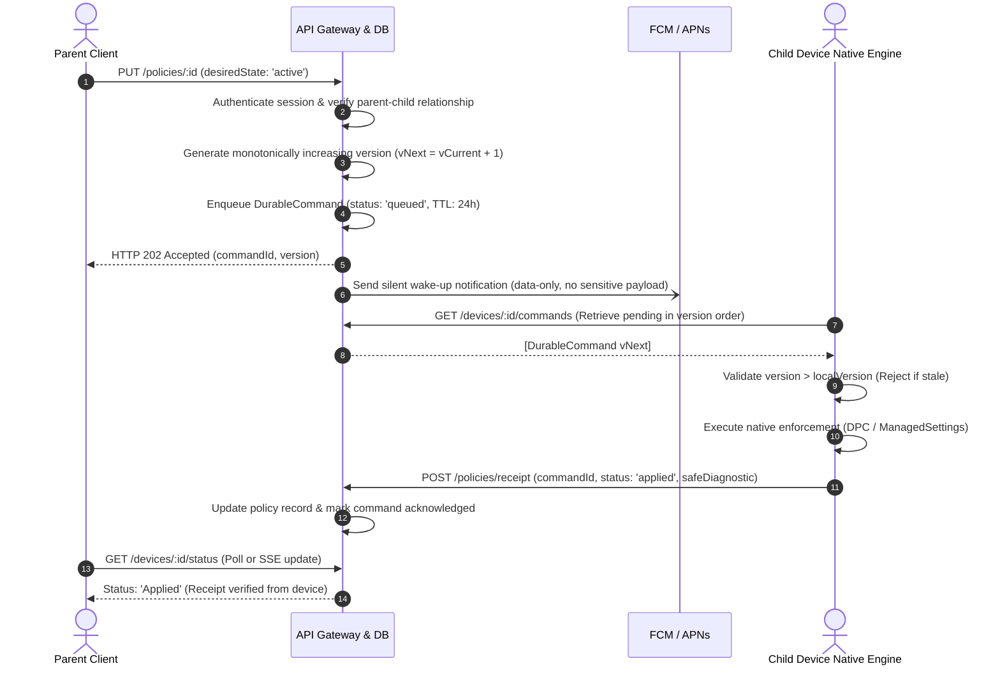

# 🔄 ZenFocus Remote Policy Synchronization Specification

## 1. Overview
The ZenFocus Policy Synchronization Engine coordinates restriction rules, study schedules, and parental commands across heterogeneous devices (Android and iOS). It guarantees that policies are versioned, idempotent, tamper-proof, and resilient to offline network conditions.

---

## 2. Synchronization Lifecycle

---

## 3. End-to-End Edge Case Handling

### 3.1 Offline Child Device
- **Behavior**: When a child device is disconnected from Wi-Fi/Cellular, the backend retains commands in the durable queue with status `offline`.
- **Local Autonomy**: Pre-authorized restrictions on the child device continue operating offline from the local cached policy store in `SharedPreferences` / `AppGroup UserDefaults`.
- **Reconnection Catch-Up**: As soon as connectivity returns, the device syncs all pending commands sorted monotonically by `policyVersion`.
- **Honest Parent UI**: While offline, the parent dashboard displays `Sync Pending (Child Device Offline)`, never falsely claiming the restriction is already active.

### 3.2 Out-of-Order & Stale Policy Delivery
- If network jitter causes policy `v2` to arrive after policy `v3`, the child enforcement engine compares `cmd.policyVersion` against `currentPolicy.version`.
- Any command where `cmd.policyVersion <= currentPolicy.version` is immediately rejected with error code `STALE_POLICY_VERSION_REJECTED` and acknowledged without modifying device state.

### 3.3 Duplicate Message Delivery
- All command executions are idempotent. If a push notification or retry delivers an already-applied `commandId`, the native engine checks its processed command set and returns an acknowledgment receipt without re-executing OS suspension calls.

### 3.4 Expired Commands
- Commands in the durable queue have a 24-hour time-to-live (`expiresAt`). If a device was powered off for a week, stale temporary commands (such as a 15-minute grace period from 5 days ago) are discarded with status `failed` (`COMMAND_EXPIRED`).

---

## 4. Platform-Specific Target Reference Resolution
Android and iOS use fundamentally different application identifiers:
- **Android**: Identifiers are package names (e.g. `com.zhiliaoapp.musically`).
- **iOS**: Identifiers are opaque `ApplicationToken` structs generated by Apple's `FamilyActivityPicker`.

**Architectural Rule**: The backend treats app targets as platform-qualified identifiers (`targetPackage` + `platform`). A policy targeted at an Android child device is never sent to an iOS device without native token re-mapping.

---

## 5. Receipt Status Matrix

| Receipt Status | Description | UI Display |
| :--- | :--- | :--- |
| `applied` | Native adapter successfully verified OS suspension or shield. | `✅ Blocked on Leo's Device` |
| `partial` | DPC succeeded but DND access was missing; or app shielded but category pending. | `⚠️ Partially Applied` |
| `offline` | Command accepted by cloud, awaiting device network reconnection. | `⏳ Sync Pending (Device Offline)` |
| `failed` | Native adapter encountered OS error or expired command. | `❌ Enforcement Failed` |
| `unsupported` | Target API unavailable on target OS version (e.g. iOS < 16.0). | `ℹ️ Unsupported OS Version` |
